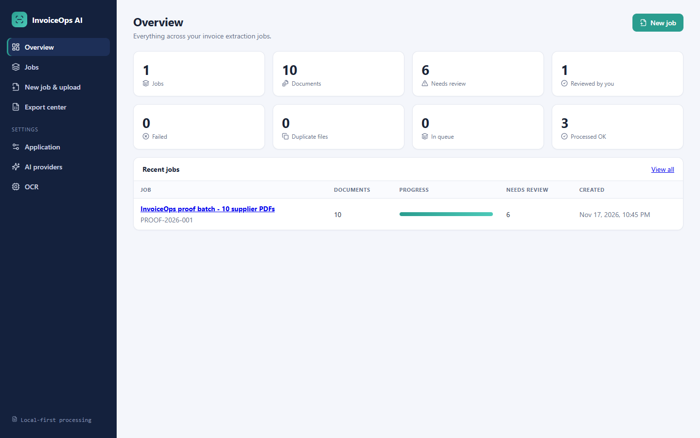
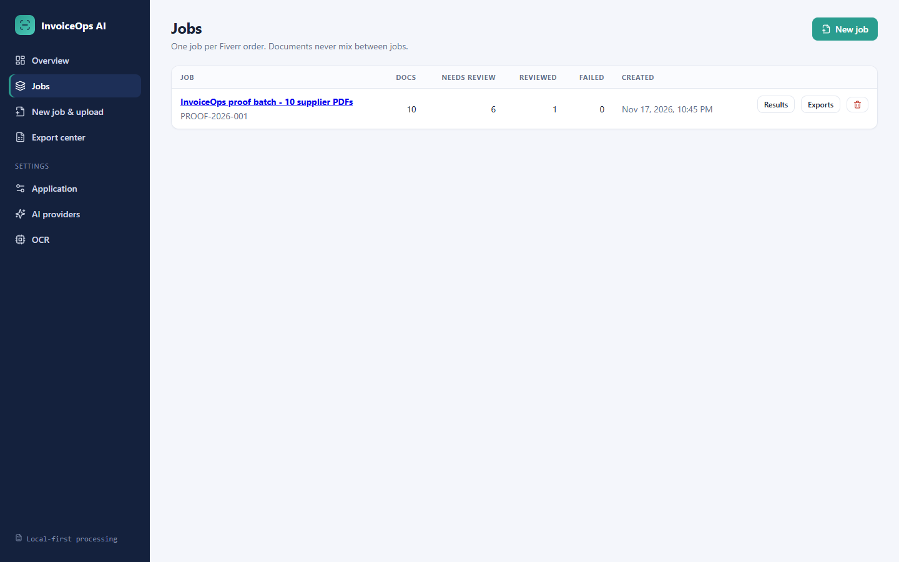
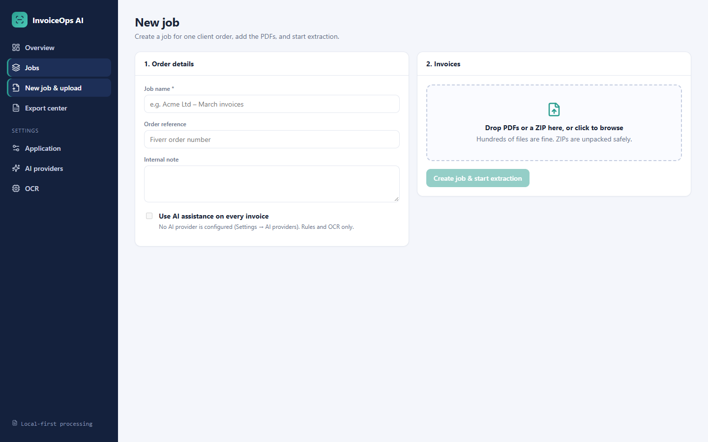
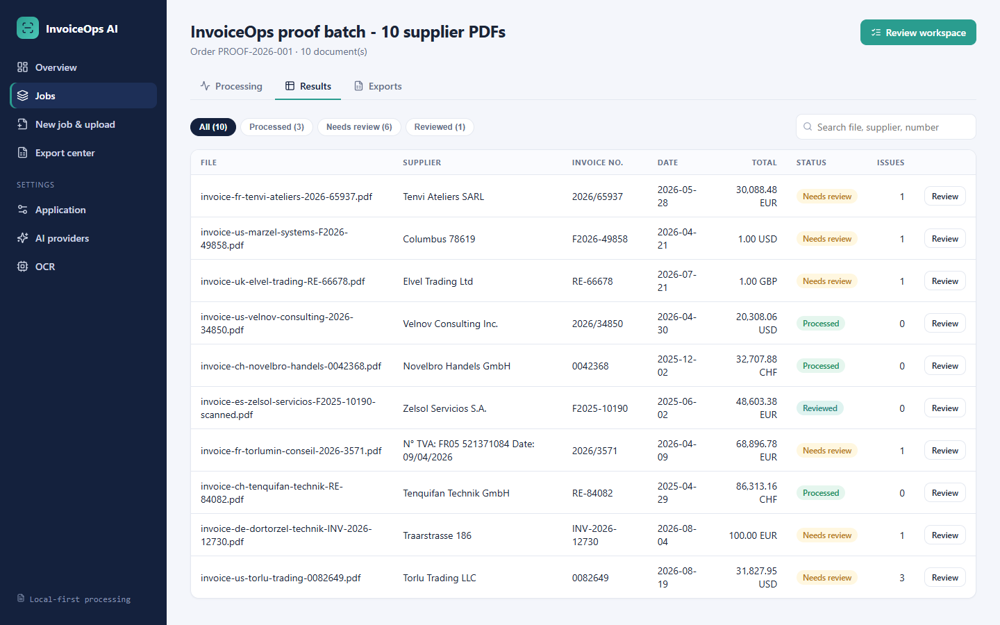
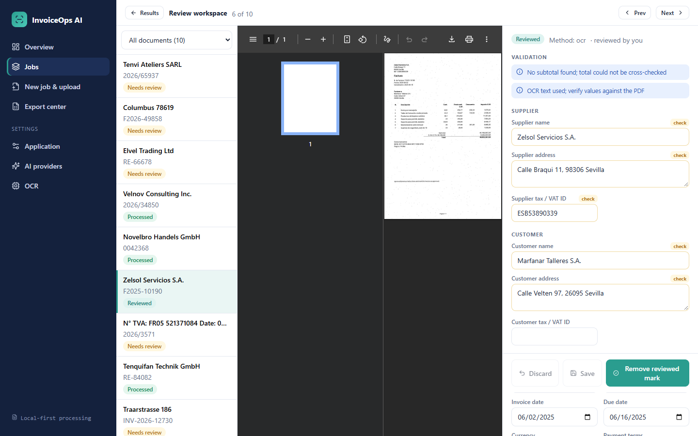
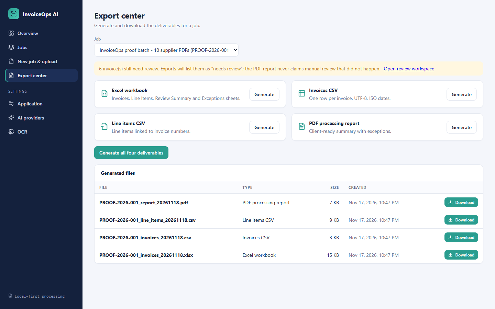
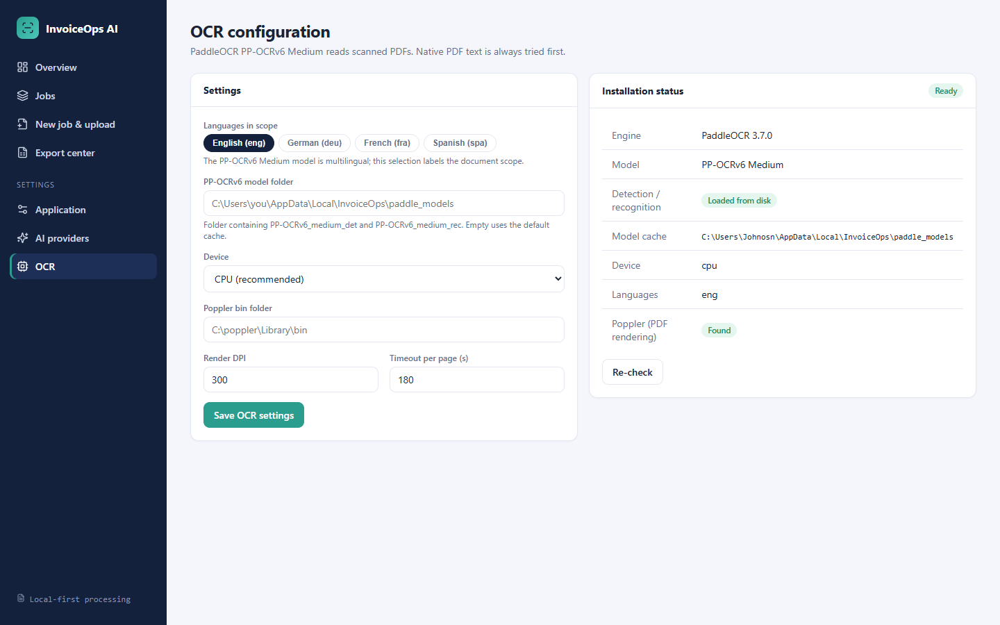
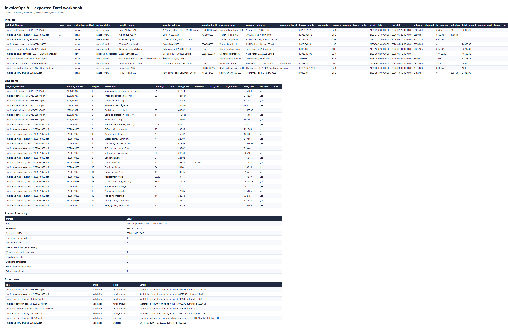

# InvoiceOps AI

[](docs/proof/logs/backend_tests.txt)
[](docs/proof/VERIFICATION.md)
[](docs/ARCHITECTURE.md)

Local-first invoice extraction platform: upload a batch of PDF invoices (or a ZIP), extract fields with native text + OCR, review every result in a side-by-side workspace, and export **Excel, two CSVs and a PDF report**.

> Built for paid invoice-processing work: one job per order, full audit trail, no mixed client data, and no cloud AI without explicit per-job consent.

## Screenshots

Real UI captures from a 10-document sample invoice batch (1440x900):

| | |
|---|---|
|  |  |
|  |  |
|  |  |
|  |  |

Full set, including the generated PDF report: [`docs/proof/screenshots/`](docs/proof/screenshots/).

## What it does

- **Batch intake** - PDF or ZIP upload, magic-byte checks, size/file-count limits, safe display names and SHA-256 duplicate detection.
- **Extraction** - native PDF text first; PaddleOCR PP-OCRv6 Medium (offline, local) only for pages without usable text. English, German, French and Spanish scope labels.
- **Money-safe parsing** - `Decimal` everywhere, locale-aware numbers (`1,234.56` and `1.234,56`), real zero tax, no float rounding.
- **Review workspace** - original PDF beside editable fields, confidence/source badges, validation warnings, original values preserved, every correction logged.
- **Exports** - 4-sheet XLSX, invoices CSV, line-items CSV and a client-ready PDF report with exceptions and honest review counts. Spreadsheet formula injection is neutralised.
- **Privacy by design** - server binds to `127.0.0.1`, optional admin token, per-job file isolation, retention purge, hard delete, secrets never returned by the API. AI is optional: local Ollama or Groq with per-job consent and grounded values only.

## Keywords

invoice OCR, invoice processing, OCR automation, PaddleOCR, PP-OCRv6, FastAPI, React, TypeScript, Python, PDF extraction, document parsing, data entry automation, XLSX export, CSV export, PDF report, local-first AI, offline OCR, bookkeeping automation, accounts payable, invoice review, audit trail

## Proof of work

Everything below was generated by running this repository, not hand-written:

| Evidence | Link |
|---|---|
| Verification summary (10 commands, 10/10 passing) | [`docs/proof/VERIFICATION.md`](docs/proof/VERIFICATION.md) |
| Raw test / lint / typecheck / build / migration logs | [`docs/proof/logs/`](docs/proof/logs/) |
| Demo run summary (uploads, statuses, corrections, exports) | [`docs/proof/outputs/demo_summary.json`](docs/proof/outputs/demo_summary.json) |
| Generated Excel workbook | [`docs/proof/outputs/invoices.xlsx`](docs/proof/outputs/invoices.xlsx) |
| Generated invoices CSV / line-items CSV | [`invoices.csv`](docs/proof/outputs/invoices.csv) · [`line_items.csv`](docs/proof/outputs/line_items.csv) |
| Generated PDF report | [`docs/proof/outputs/processing_report.pdf`](docs/proof/outputs/processing_report.pdf) |
| Fiverr-ready portfolio copy | [`docs/FIVERR_PORTFOLIO.md`](docs/FIVERR_PORTFOLIO.md) |

Regenerate it all:

```bat
python scripts\verify.py
python scripts\make_demo.py
python scripts\capture_proof.py
```

`verify.py` needs the dev dependencies; `capture_proof.py` additionally needs Playwright and a local Chrome install. The ten demo input PDFs are kept in `docs/proof/outputs/`.

## Quick start (Windows)

1. Install Python 3.12+, PostgreSQL 15+ and Poppler - see [`docs/WINDOWS_SETUP.md`](docs/WINDOWS_SETUP.md).
2. Copy `.env.example` to `.env`, set your database password and Poppler path. `scripts\setup.bat` downloads the PP-OCRv6 Medium models automatically.
3. Run `scripts\setup.bat`, then `scripts\start.bat`.
4. Open `http://127.0.0.1:8000`. The frontend is prebuilt in `frontend/dist`, so Node is not needed to run it.

Daily workflow: [`docs/USER_GUIDE.md`](docs/USER_GUIDE.md) · AI setup: [`docs/AI_SETUP.md`](docs/AI_SETUP.md) · troubleshooting: [`docs/TROUBLESHOOTING.md`](docs/TROUBLESHOOTING.md) · internals: [`docs/ARCHITECTURE.md`](docs/ARCHITECTURE.md).

## Quality checks

| Area | Command | Result |
|---|---|---|
| Backend tests (SQLite + optional PostgreSQL via `TEST_DATABASE_URL`) | `python -m pytest -q` | 68 passed |
| Backend lint / format | `ruff check .` / `ruff format --check .` | clean |
| Frontend typecheck / lint / format / build | `npm run typecheck && npm run lint && npm run format:check && npm run build` | clean |
| Database schema | `alembic upgrade head && alembic check && alembic downgrade base` | clean |

## Layout

```
backend/   FastAPI API, extraction engine, AI providers, exporters, Alembic migrations, samples, tests
frontend/  React + TypeScript SPA (Vite), prebuilt dist/
docs/      setup, user guide, architecture, troubleshooting, Fiverr portfolio, generated proof
scripts/   setup.bat, start.bat, test.bat, verify.py, make_demo.py, capture_proof.py
```

Dependencies are pinned (`backend/requirements*.txt`, `frontend/package-lock.json`). `.env`, local data and job files are gitignored.
